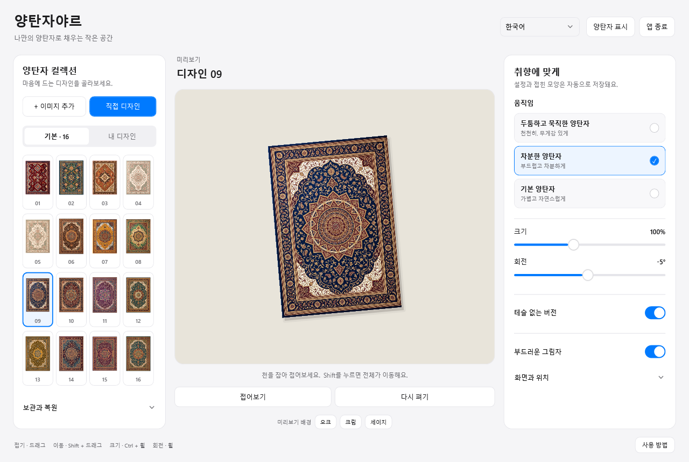
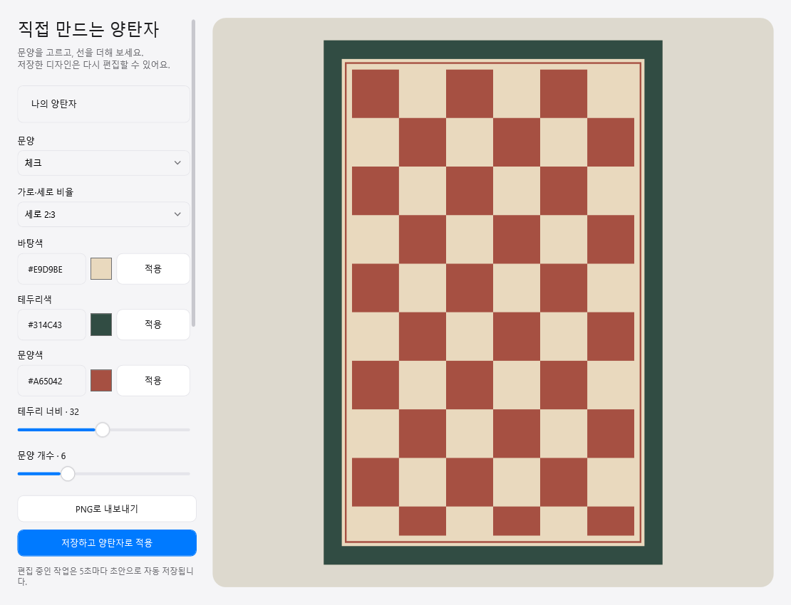

# 양탄자야르

**Windows 바탕화면 위에 놓는 작은 양탄자.**

한국어 · [English](README.md)

모서리를 잡고 살짝 접어, 아래에 있는 아이콘을 확인해 보세요. 16가지 디자인을 고르거나, 원하는 이미지를 넣거나, 편집기에서 나만의 양탄자를 그릴 수 있습니다.

**무료 베타 · 0.4.11 · Windows x64**

[Windows 설치 파일 받기](https://github.com/qkdlsem-maker/yangtanjar/releases/download/v0.4.11-beta.1/Yangtanjar-0.4.11-Setup-x64.exe) · [버전 안내](https://github.com/qkdlsem-maker/yangtanjar/releases/tag/v0.4.11-beta.1) · [문제 제보](https://github.com/qkdlsem-maker/yangtanjar/issues/new/choose)

함께 사용해 보고 개선하기 위한 베타입니다. 간헐적인 버벅임과 복잡한 접힘·긴 테슬의 겹침 현상이 남아 있습니다. [알려진 문제](docs/KNOWN-ISSUES.md)를 확인해 주세요.

## 내 취향에 맞게

- 바탕화면에서 양탄자를 잡고 접거나 이동하고, 크기와 각도를 조절합니다.
- **두툼하고 묵직한 양탄자 / 차분한 양탄자 / 기본 양탄자** 중 움직임을 고릅니다. 차분한 양탄자는 0.4.6의 움직임 계산을 유지합니다.
- 테슬을 숨기거나 길이·색상을 바꿉니다.
- 기본 디자인 16종, 이미지 추가, 문양 편집과 자유 그리기를 제공합니다.
- 다음 실행에 저장된 접힌 모양을 복원하고, 초안과 디자인을 백업합니다.
- **한국어·영어 메뉴**를 지원합니다. 언어 변경은 앱을 종료하고 다시 실행하면 적용됩니다.

## 시작하기

1. 베타 릴리스에서 `Yangtanjar-0.4.11-Setup-x64.exe`를 받습니다.
2. 설치한 뒤 시작 메뉴에서 **양탄자야르 / Yangtanjar**를 실행합니다.
3. 디자인을 고르고 설정 창을 닫으면 바탕화면에서 사용할 수 있습니다.

처음 실행할 때는 Windows 언어에 따라 한국어 또는 영어로 표시합니다. 오른쪽 위에서 언어를 선택한 뒤 **앱 종료**를 누르고 다시 실행해 주세요. 설정 창의 닫기 버튼만 누르면 앱은 계속 실행됩니다.

현재 설치 파일은 **디지털 서명이 없는 베타**입니다. Windows에서 게시자나 평판 확인 경고가 나타날 수 있습니다. 파일이 확실하지 않으면 설치를 취소하세요. [설치 안내](docs/INSTALL.ko.md)와 릴리스의 `SHA256SUMS.txt`를 함께 제공합니다.

Windows 10 버전 2004 이상 / Windows 11, x64, .NET Framework 4.8 이상이 필요합니다. 다양한 PC·화면 배율·다중 모니터 환경은 추가 검증 중입니다. Windows 기본 대화상자는 Windows 언어를 따를 수 있습니다.

## 조작 방법

| 하고 싶은 일 | 조작 |
| --- | --- |
| 잡고 접기 | 양탄자 드래그 |
| 전체 이동 | Shift + 드래그 |
| 크기 조절 | Ctrl + 마우스 휠 |
| 회전 | 마우스 휠 |
| 아래 아이콘 조작 | Alt 누르기 |
| 숨기기 / 표시 | Ctrl + Alt + Shift + R |
| 가운데로 가져와 펴기 | Ctrl + Alt + Backspace |
| 설정 열기 | 양탄자 우클릭 또는 트레이 아이콘 두 번 클릭 |

양탄자는 바탕화면 파일을 이동하거나 삭제하지 않습니다. 일반 프로그램 창을 열면 그 뒤에 표시되도록 설계되어 있습니다. 창을 가리는 경우 제보해 주세요.

## 사용해 본 이야기를 들려주세요

며칠 동안 써 보고, 언제 버벅였는지, 접힌 모양이 어땠는지, 계속 켜 두고 싶은지 알려주세요. [한국어·영어 제보 양식](https://github.com/qkdlsem-maker/yangtanjar/issues/new/choose)을 준비했습니다. 화면을 첨부할 때는 개인 파일 이름과 알림을 가려 주세요.

## 데이터와 출처

회원 가입·광고·분석 서비스·자동 업데이트 다운로드가 없습니다. 설정과 초안, 추가한 이미지는 이 PC에 저장합니다. GitHub 제보는 공개 게시물이며 앱의 저장 기능과 별개입니다. [개인정보 안내](docs/PRIVACY.md)를 확인해 주세요.

관리자: [qkdlsem-maker](https://github.com/qkdlsem-maker). Terkel의 바탕화면 양탄자 아이디어에서 영감을 받은 독립 Windows 앱입니다. Terkel 또는 desktop.cleaning의 공식 제품은 아닙니다.

천 움직임 계산은 MIT 라이선스의 [siliconbag/under-the-rug](https://github.com/siliconbag/under-the-rug)를 바탕으로 옮겼습니다. [출처 안내](THIRD-PARTY-NOTICES.txt)와 [원본 라이선스](docs/licenses/siliconbag-MIT.txt)를 함께 제공합니다. 양탄자 디자인 이미지는 해당 MIT 라이선스와 별개입니다.

이 저장소에는 베타 소개·사용 안내·문제 제보 양식이 들어 있습니다. 앱 소스와 디자인 작업 원본은 포함하지 않습니다. 무료 베타라는 뜻이 앱 전체와 디자인을 MIT 라이선스로 공개한다는 뜻은 아닙니다.
