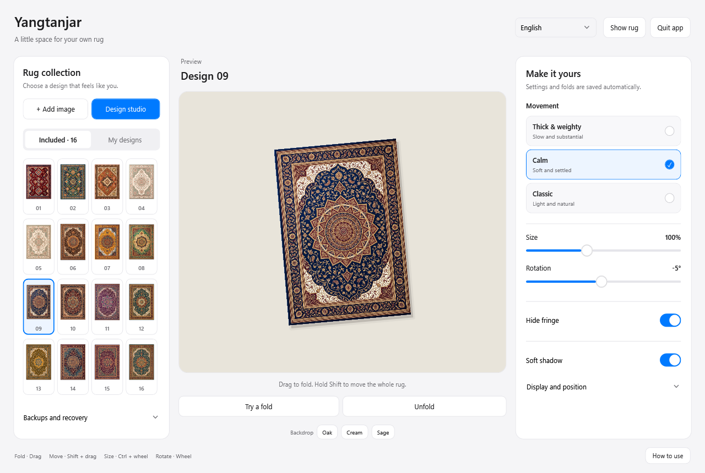
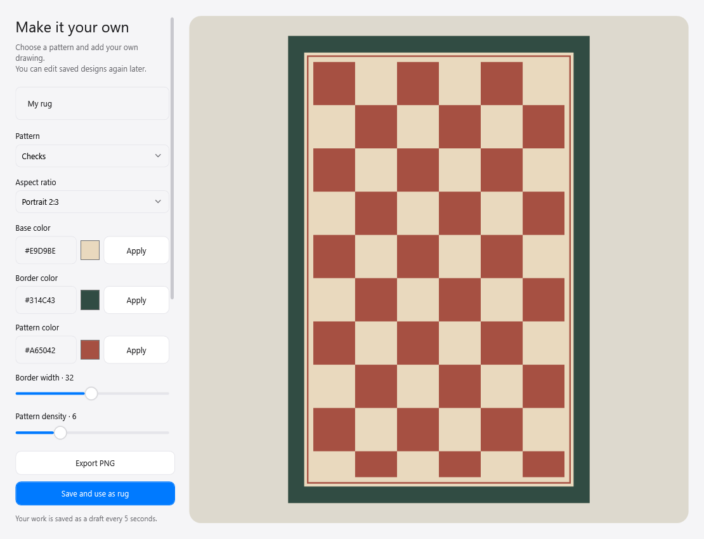

# Yangtanjar

**A little rug for your Windows desktop.**

[한국어](README.ko.md) · English

Drag a corner, fold it back, and reveal the icons underneath. Choose one of 16 rug designs, bring your own image, or draw a rug in the built-in design studio.

**Free beta · 0.4.11 · Windows x64**

[Download the Windows installer](https://github.com/qkdlsem-maker/yangtanjar/releases/download/v0.4.11-beta.1/Yangtanjar-0.4.11-Setup-x64.exe) · [Release notes](https://github.com/qkdlsem-maker/yangtanjar/releases/tag/v0.4.11-beta.1) · [Report a problem](https://github.com/qkdlsem-maker/yangtanjar/issues/new/choose)

This beta is for trying the app and helping improve it. Occasional stutter and visual overlap around complex folds and long fringe remain. See [known issues](docs/KNOWN-ISSUES.md).

## Make it yours

- Lift, fold, resize and rotate the rug on your desktop.
- Choose **Thick & weighty**, **Calm**, or **Classic** movement. Calm retains the 0.4.6 motion calculations.
- Hide fringe, or adjust its length and color.
- Pick from 16 designs, import a PNG/JPEG/BMP, or create patterns and freehand drawings.
- Restore your saved desktop folds on the next launch. Keep drafts, and back up your designs and settings.
- Use the app in **English or Korean**. Language changes apply after quitting and reopening the app.

## Get started

1. Download `Yangtanjar-0.4.11-Setup-x64.exe` from the beta release.
2. Run the installer and open **Yangtanjar** from the Start menu.
3. Choose a rug, then close the settings window to try it on your desktop.

The initial language follows Windows: Korean on Korean Windows, English otherwise. Use the language selector at the top right to override it, choose **Quit app**, then reopen. Closing the settings window alone keeps the app running.

The installer is **not digitally signed**. Windows may show a publisher or reputation warning. If you are unsure about the file, cancel installation. See the [installation guide](docs/INSTALL.en.md) and the release's `SHA256SUMS.txt`.

Requires Windows 10 version 2004 or later / Windows 11, x64, and .NET Framework 4.8 or later. This beta has limited testing across hardware, display scaling and multiple monitors. Windows system dialogs may follow the Windows language.

## Controls

| Action | Control |
| --- | --- |
| Lift and fold | Drag the rug |
| Move the whole rug | Shift + drag |
| Resize | Ctrl + mouse wheel |
| Rotate | Mouse wheel |
| Use icons underneath | Hold Alt |
| Hide / show | Ctrl + Alt + Shift + R |
| Center and unfold | Ctrl + Alt + Backspace |
| Open settings | Right-click the rug, or double-click its system tray icon |

The app keeps your desktop files in place. It does not move or delete them. Normal application windows are intended to cover the rug; if that fails, please report it.

## Help shape the beta

Try it for a few days. Tell us when dragging feels slow, whether folds look wrong, and whether you want to keep using it. [English and Korean report forms](https://github.com/qkdlsem-maker/yangtanjar/issues/new/choose) are available. A cropped screenshot or short clip helps; hide personal files and notifications first.

## Data and credits

The app has no account, advertising, analytics or automatic update downloads. Settings, drafts and imported images stay on your PC. GitHub issues are public and are separate from the app. Read the [privacy information](docs/PRIVACY.md).

Maintained by [qkdlsem-maker](https://github.com/qkdlsem-maker). This is an independent Windows app, inspired by Terkel's desktop-rug concept. It is not an official Terkel or desktop.cleaning release.

The cloth solver is adapted from [siliconbag/under-the-rug](https://github.com/siliconbag/under-the-rug) under the MIT License. See [credits and notices](THIRD-PARTY-NOTICES.txt) and the [upstream license](LICENSE-siliconbag.txt). The bundled rug artwork is separate from that license.

This repository contains the beta's documentation and issue forms. Application source code and original artwork project files are not included. A free beta does not mean the whole application or its artwork is MIT-licensed.
